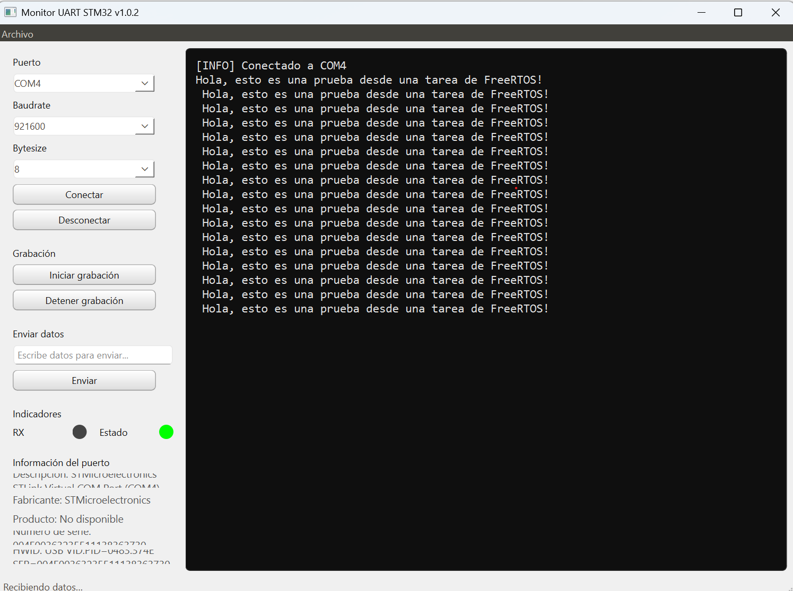

# 🛠️ MonitorUART

[](https://www.python.org/)
[](https://www.riverbankcomputing.com/software/pyqt/)
[](../../releases)
[](LICENSE)

**MonitorUART** es una aplicación de escritorio moderna desarrollada con Python 3.12 y PyQt6 para la monitorización, depuración y registro en tiempo real de comunicaciones serie (UART / Puerto COM).

---

## 📸 Captura de Pantalla

> 

---

## ✨ Características Principales

- 🔌 **Gestión Serie Robusta:** detección automática de puertos COM (ordenados y con descripción), baudrate, bytesize, paridad y bits de parada.
- 🗂️ **Terminales por tipo de mensaje:** además de la consola **General**, cada tipo de mensaje tiene su propia pestaña (Errores `[ERR]`, Test `[TST]`, Flash `[FL1]`, Web `[WEB]`...), con su color y contador de líneas nuevas.
- ⚙️ **Terminales configurables desde la app:** menú *Terminales → Gestionar terminales* (`Ctrl+M`) para crear, editar, ordenar, activar o borrar terminales. Filtros por *empieza por*, *contiene* o *expresión regular*, con prueba en vivo. Se guardan en `%APPDATA%\MonitorUART\terminales.json`.
- 🧹 **Limpiar con un botón:** cada consola tiene su botón *Limpiar*, y hay un botón para limpiar todas (`Ctrl+Shift+L`).
- 🔎 **Buscar, guardar y auto-scroll** en cada consola.
- 📋 **Comandos guardados:** panel lateral (`Ctrl+K`) con los comandos del firmware. Categorías que puedes crear, renombrar, ordenar y borrar; ★ Favoritos; parámetros que recuerdan los últimos valores; vista previa; confirmación en los borrados; **envío repetido cada X ms**; clic derecho para mover de categoría, copiar o duplicar; importar/exportar. Se guardan en `%APPDATA%\MonitorUART\comandos.json`.
- 🔔 **Alertas por terminal:** sonido y parpadeo en la barra de tareas cuando llega un mensaje de una terminal marcada (Errores, por defecto).
- 📊 **Estadísticas en vivo:** velocidad de recepción (kB/s), bytes y envíos TX y tiempo de conexión.
- 🎯 **Recuerda tu placa por su número de serie**, aunque Windows le cambie el número de COM.
- ⚡ **F5** para conectar/desconectar, opciones de **limpiar** y **grabar automáticamente al conectar** (en `Documentos\MonitorUART\Grabaciones`), tamaño del texto (`Ctrl +` / `Ctrl -` / `Ctrl 0`) y ajuste de líneas largas.
- ⏸️ **Pausa de visualización** sin perder datos (se acumulan y se muestran al reanudar).
- 🕒 **Marcas de tiempo** opcionales con milisegundos.
- 🔁 **Reconexión automática** cuando la placa se resetea o se reconecta el USB.
- ⌨️ **Envío con historial** (flechas ↑/↓) y fin de línea configurable (LF, CR+LF, CR o ninguno).
- 🧵 **Multihilo con QThread:** lectura por líneas y en lotes, sin congelar la interfaz aunque haya mucho tráfico.
- 📂 **Grabación en tiempo real** de todo lo recibido y exportación de cada consola.
- 💾 **Recuerda la configuración** (puerto, baudios, tamaño de ventana...).
- ⚠️ **Errores amigables** (puerto ocupado, dispositivo desconectado) y registro interno en `%APPDATA%\MonitorUART\monitoruart.log`.

### ⌨️ Atajos de teclado

| Atajo | Acción |
|---|---|
| `F5` | Conectar / desconectar |
| `Ctrl+L` | Limpiar la consola visible |
| `Ctrl+Shift+L` | Limpiar todas las consolas |
| `Ctrl+M` | Gestionar terminales |
| `Ctrl+K` | Mostrar/ocultar el panel de comandos |
| `Ctrl+N` | Nuevo comando |
| `Ctrl+T` | Mostrar/ocultar marcas de tiempo |
| `Ctrl+P` | Pausar/reanudar visualización |
| `Ctrl+S` / `Ctrl+Shift+S` | Guardar consola actual / todas |
| `Ctrl +` / `Ctrl -` / `Ctrl 0` | Tamaño del texto |
| `Ctrl+Q` | Salir |

---

## 📥 Descarga Ejecutable (Windows)

No necesitas tener Python ni ninguna librería instalada para usar la aplicación. Puedes descargar el ejecutable listo para usar desde la sección de entregas:

👉 **[Descargar MonitorUART.exe en Releases](../../releases/latest)**

---

## 🛠️ Instalación para Desarrolladores

### 1. Desde el Ejecutable (Windows)
Descarga la última versión empaquetada directamente desde la sección de [Releases](../../releases).

### 2. Ejecutar desde el código fuente

```bash
# Clonar el repositorio
git clone https://github.com/edujimser/MonitorUart.git
cd MonitorUart

# Crear y activar entorno virtual
python -m venv venv
# En Windows:
venv\Scripts\activate

# Instalar dependencias
pip install -r requirements.txt

# Ejecutar la aplicación
python main.py
